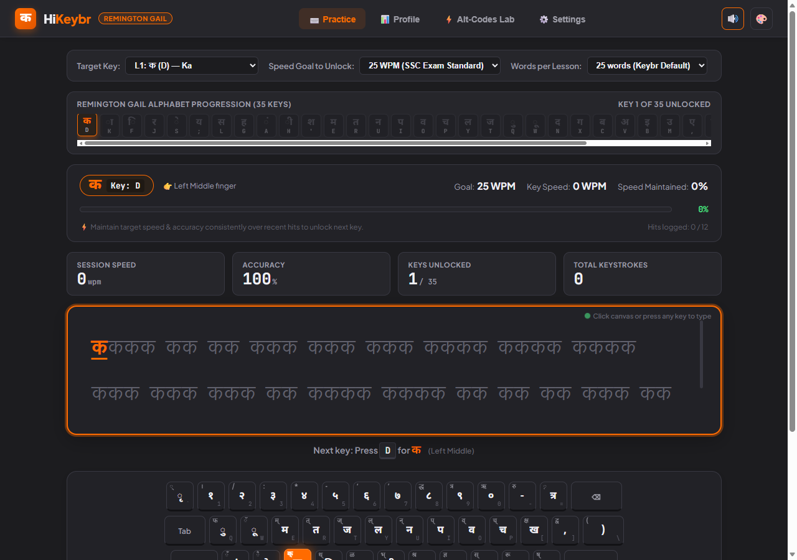

# HiKeybr ⌨️

**HiKeybr** is an adaptive Hindi typing tutor specifically designed for the **Remington (GAIL)** layout, built in the aesthetic and pedagogical spirit of [keybr.com](https://www.keybr.com).

---

## 🌟 Key Features

- **Keybr.com Inspired Interface**: Clean dark/navy/amber/light themes, active letter mastery cards, live keystroke analytics, and an interactive virtual Remington keyboard.
- **Strict Error Blocking**: Wrong keystrokes do not advance the cursor. The cursor shakes red, sounds an error chime, records an accuracy penalty, and waits for the correct key.
- **Authentic KrutiDev 010 Engine**:
  - Embedded **KrutiDev 010** font renders complete Hindi words cleanly without broken OpenType ligatures.
  - **Half-Letter Highlighting**: When typing composite letters (e.g., `श` typed as `'` + `k`), typing `'` highlights **only the half-letter `श्`** in green, and `k` completes the full consonant.
  - **Chhoti `ि` Matra (`f`)**: Typed before the consonant, matching authentic Remington GAIL typewriter rules.
  - **Reph `र्` (`Shift + Z`)**: Typed after the consonant, moving above automatically.
- **25 Words per Lesson**: Keybr standard phonotactic drills generated strictly from currently unlocked keys.
- **Speed-Maintenance Progression**: Keys unlock only after sustaining target speed (e.g. 25 WPM) with $\ge 90\%$ accuracy across a 15-hit rolling window.
- **Alt-Codes Lab & Interactive Reference**: Built-in reference and sandbox for Hindi special conjuncts (e.g., `Alt + 0204` for `क्त`, with equivalent laptop GAIL sequences like `d = r`).

---

## 🚀 Running Locally or Deploying

HiKeybr is a standalone, single-page application with zero build tools or server dependencies required.

1. **Local Run**: Double click `index.html` or open with any modern web browser.
2. **GitHub Pages**:
   - Go to **Settings** > **Pages** in this repository.
   - Set **Branch** to `main` and folder to `/ (root)`.
   - Click **Save**. Your typing tutor is live on the web!

---

## 📜 Keyboard Layout Reference (Remington GAIL)

| Hindi | Physical Key | Shift Key | Finger |
| :--- | :--- | :--- | :--- |
| **क** | `d` | `D` (`क्`) | Left Middle |
| **ा** | `k` | `K` (`ज्ञ`) | Right Middle |
| **ि** | `f` | `F` (`थ्`) | Left Index |
| **र** | `j` | `J` (`श्र`) | Right Index |
| **े** | `s` | `S` (`ै`) | Left Ring |
| **य** | `;` | `:` (`रू`) | Right Pinky |
| **स** | `l` | `L` (`स्`) | Right Ring |
| **ह** | `g` | `G` (`ळ`) | Left Index |
| **ं** | `a` | `A` (`।`) | Left Pinky |
| **ी** | `h` | `H` (`भ्`) | Right Index |
| **श** | `'` + `k` | `"` (`ष्`) | Right Pinky |
| **म** | `e` | `E` (`म्`) | Left Middle |
| **त** | `r` | `R` (`त्`) | Left Index |
| **न** | `u` | `U` (`न्`) | Right Index |
| **प** | `i` | `I` (`प्`) | Right Middle |
| **व** | `o` | `O` (`व्`) | Right Ring |
| **च** | `p` | `P` (`च्`) | Right Pinky |
| **ल** | `y` | `Y` (`ल्`) | Right Index |
| **ज** | `t` | `T` (`ज्`) | Left Index |
| **ु** | `q` | `Q` (`फ`) | Left Pinky |
| **ू** | `w` | `W` (`ॅ`) | Left Ring |
| **द** | `n` | `N` (`छ`) | Right Index |
| **ग** | `x` | `X` (`ग्`) | Left Ring |
| **ब** | `c` | `C` (`ब्`) | Left Middle |
| **अ** | `v` | `V` (`ट`) | Left Index |
| **इ** | `b` | `B` (`ठ`) | Left Index |
| **उ** | `m` | `M` (`ड`) | Right Index |
| **ए** | `,` | `<` (`ढ`) | Right Middle |
| **ण** | `.` + `k` | `>` (`झ`) | Right Ring |
| **ध** | `/` + `k` | `?` (`घ्`) | Right Pinky |
| **्र** | `z` | `Z` (`र्`) | Left Pinky |
| **ख** | `[` + `k` | `{` (`क्ष्`) | Right Pinky |
| **ृ** | `` ` `` | `~` (`्`) | Left Pinky |
| **त्र**| `=` | `+` (`़`) | Right Pinky |
